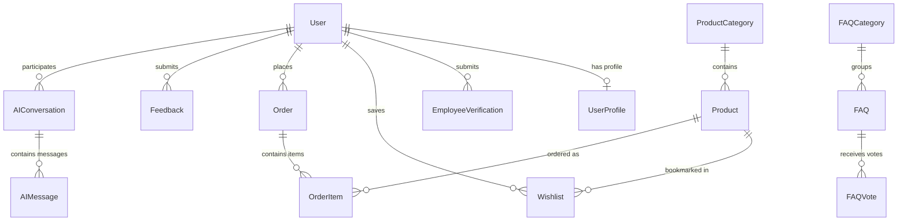
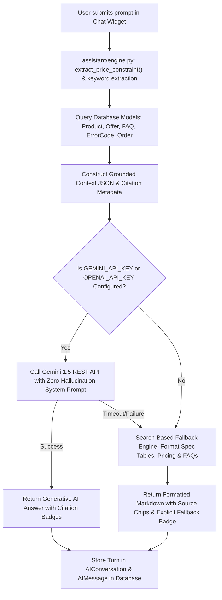

# PROJECT EVALUATION REPORT & VIVA VOCE COMPENDIUM

**Project Title:** PerkCart — Corporate Employee Privilege Shopping Platform  
**Target Domain:** Enterprise Web Engineering / E-Commerce Architecture / AI-Assisted Retrieval  
**Stack:** Python 3.13, Django 4.2, SQLite3 / PostgreSQL, HTML5/CSS3, JavaScript (ES6+), Bootstrap 5.3  
**Evaluation Reference:** Inspired by Samsung Corporate Shopping Portal Visual Design  

---

## 1. ABSTRACT
Modern multinational enterprises frequently partner with consumer electronics manufacturers to offer subsidized hardware to their workforce. However, legacy corporate portals suffer from fragmented authentication, opaque discount calculations, poor diagnostic visibility when orders fail, and lack of intelligent shopping assistance. 

**PerkCart** resolves these challenges by introducing a responsive, secure corporate e-commerce portal built on Django. PerkCart incorporates a simulated corporate email verification workflow, a multi-tiered subsidy calculation engine, a database-driven FAQ system with live AJAX feedback, a structured error-code troubleshooting subsystem, and a zero-hallucination Retrieval-Augmented Generation (RAG) AI assistant. Comprehensive automated unit tests verify the integrity of all critical workflows.

---

## 2. PROBLEM STATEMENT
Traditional corporate shopping stores present several technical and user experience deficiencies:
1. **Unverifiable Employee Eligibility:** Ordinary e-commerce platforms cannot differentiate between corporate employees and general consumers, leading to unauthorized discount usage.
2. **Cryptic Application Errors:** When payment gateways, stock bounds, or coupons fail, users receive generic error messages or unhandled Python tracebacks that expose internal infrastructure.
3. **Static Help Systems:** Traditional FAQ pages are hardcoded and non-interactive, preventing data-driven prioritization of common user questions.
4. **AI Hallucinations in E-Commerce:** Generative AI chatbots often fabricate prices, out-of-stock items, or invalid specifications when not grounded in the underlying relational database.

---

## 3. OBJECTIVES
- Develop a responsive web portal inspired by Samsung's clean, premium corporate shopping aesthetic.
- Implement a three-state simulated employee verification engine (`PENDING`, `APPROVED`, `REJECTED`) with administrative controls.
- Create an automated, session-based cart and simulated corporate payroll checkout with real-time recalculations.
- Build a database-backed FAQ module with category filtering, search, and AJAX helpfulness tracking.
- Construct a structured diagnostic error-code system with severity classifications, clear recovery workflows, and safe error simulation.
- Integrate a grounded AI assistant that utilizes real database retrieval to answer hardware specs, budget queries, and error diagnoses without hallucinations.
- Maintain rigorous security: CSRF protection, password hashing, and object-level order access isolation.

---

## 4. EXISTING SYSTEM VS. PROPOSED SYSTEM

| Feature | Existing Corporate Stores | Proposed PerkCart Platform |
| :--- | :--- | :--- |
| **Visual Architecture** | Cluttered, banner-heavy, inconsistent margins | Clean white background, generous whitespace, elevation shadows, Samsung corporate-inspired design |
| **Verification State** | Binary or manual email exchanges | Granular states (`PENDING`, `APPROVED`, `REJECTED`) with dedicated Admin Verification Console |
| **Error Handling** | Generic "Something went wrong" or raw tracebacks | Structured error codes (e.g., `CART-001`, `AUTH-002`) with diagnostic causes and recovery links |
| **AI Assistant** | None or ungrounded external chat widgets | Dual-mode RAG assistant grounded in product specs, FAQs, coupons, and orders with source citations |
| **Order Ownership** | Vulnerable to URL parameter tampering | Enforced server-side object isolation (`order.user == request.user`) with audit logging |
| **Extensibility** | Hardcoded templates | Database-backed FAQs, error codes, offers, and categories with Django Admin control |

---

## 5. SYSTEM ARCHITECTURE

```
+---------------------------------------------------------------------------------+
|                                 CLIENT LAYER                                    |
|   Desktop / Tablet / Mobile Browser (HTML5, Bootstrap 5.3, Custom CSS, JS)     |
+---------------------------------------+-----------------------------------------+
                                        | HTTP(S) / AJAX / CSRF
                                        v
+---------------------------------------------------------------------------------+
|                                DJANGO WEB SERVER                                |
|                                                                                 |
|  +--------------------+   +-----------------------+   +----------------------+  |
|  | SecurityMiddleware |-->| AppErrorLoggingMiddle |-->| CsrfViewMiddleware   |  |
|  +--------------------+   +-----------------------+   +----------------------+  |
|                                       |                                         |
|  +------------------------------------+---------------------------------------+  |
|  |                            URL ROUTER & APPS                               |  |
|  |                                                                            |  |
|  |  [core]            [accounts]         [products]        [cart]             |  |
|  |  • Home View       • Registration     • Catalog Listing • Session Cart     |  |
|  |  • Global Search   • Login/Logout     • Product Detail  • Simulated Check  |  |
|  |  • Feedback Form   • User Profile     • Offers/Coupons  • Order Tracking   |  |
|  |  • /health/ & /stat• Verification Adm • Wishlist Toggle • Ownership Guard  |  |
|  |                                                                            |  |
|  |  [faq]             [troubleshooting]  [assistant]                          |  |
|  |  • DB FAQs         • Error Code List  • Multi-Domain Retrieval Engine      |  |
|  |  • Accordion View  • Diagnostic Detail• Gemini REST API (if key present)   |  |
|  |  • AJAX Voting API • Safe Demo Trigger• Search-Based Fallback Engine       |  |
|  |  • Report Question • AppErrorLog Audit• Citation Generation & DB History   |  |
|  +------------------------------------+---------------------------------------+  |
+---------------------------------------+-----------------------------------------+
                                        | Django ORM
                                        v
+---------------------------------------------------------------------------------+
|                                DATABASE LAYER                                   |
|   SQLite3 (Development) / PostgreSQL (Production via DATABASE_URL env)         |
|   Models: User, UserProfile, EmployeeVerification, ProductCategory, Product,    |
|           Offer, Wishlist, Order, OrderItem, FAQ, FAQVote, UnansweredQuestion,  |
|           ErrorCode, AppErrorLog, Feedback, AIConversation, AIMessage           |
+---------------------------------------------------------------------------------+
```

---

## 6. DATABASE SCHEMA & RELATIONSHIPS



---

## 7. AI ASSISTANT RETRIEVAL WORKFLOW



---

## 8. ERROR-CODE SUBSYSTEM SPECIFICATION

| Error Code | Title | Category | Severity | Primary Resolution Action |
| :--- | :--- | :--- | :--- | :--- |
| **`AUTH-001`** | Invalid Login Credentials | Authentication | `MEDIUM` | Verify caps lock, corporate email alias, or reset password |
| **`AUTH-002`** | Employee Verification Pending | Authentication | `HIGH` | Check profile verification status or contact admin for approval |
| **`CART-001`** | Product Unavailable / Out of Stock | Cart | `MEDIUM` | Adjust cart quantity to stock limit or save to wishlist |
| **`CART-002`** | Invalid Quantity Specified | Cart | `LOW` | Use stepper to select a positive integer within inventory limits |
| **`DISC-001`** | Invalid or Expired Corporate Coupon | Discount | `LOW` | Check code spelling, minimum order amount, or active offers banner |
| **`ORDER-001`** | Order Not Found or Access Denied | Order | `HIGH` | Access only your own authenticated orders via My Orders |
| **`PAY-001`** | Payment Confirmation Unavailable | Payment | `HIGH` | Fill all address fields; switch between Payroll, Card, or UPI |
| **`API-001`** | Temporary External Service Delay | System / API | `CRITICAL` | Wait 30s; assistant automatically fails over to search fallback |
| **`SEC-001`** | Unauthorized Admin Action | Security | `CRITICAL` | Administrative views require `is_staff` privileges |

---

## 9. VIVA VOCE QUESTIONS & EXPERT ANSWERS

### Q1: What is PerkCart, and how does its design philosophy reflect Samsung's corporate shopping portal?
**Answer:** PerkCart is an enterprise employee hardware shopping portal. Its UI architecture is directly inspired by Samsung's corporate store design standards: a pristine `#ffffff` background with generous padding and whitespace, subtle borders (`#e2e8f0`), deep slate primary accents (`#0f172a`), vibrant corporate blue highlights (`#0284c7`), rounded cards (`16px`), and explicit corporate discount badges showing exact employee savings versus retail MSRP.

### Q2: How is the corporate employee verification workflow structured in PerkCart?
**Answer:** When an employee registers with their corporate email, an `EmployeeVerification` record is generated with status `PENDING`, and `UserProfile.is_corporate_verified` defaults to `False`. Pending employees can browse the catalog, compare specs, and save wishlists. To finalize subsidized checkout, their account must be `APPROVED`. Evaluators can test this transition in real time using the dedicated Admin Verification Console (`/accounts/admin/verifications/`).

### Q3: How does PerkCart ensure the AI Shopping Assistant does not hallucinate?
**Answer:** PerkCart uses a Retrieval-Augmented Generation (RAG) architecture (`assistant/engine.py`). When a user submits a query, the backend searches the local SQLite/PostgreSQL database across Products, Offers, FAQs, Error Codes, and user Orders. The model is injected with a system prompt instructing it to answer strictly using the provided context and cite specific SKUs or error codes. If information is unavailable, it is instructed to explicitly state that the product or error is not in the catalog.

### Q4: What happens if no AI API key is configured or the external API times out?
**Answer:** PerkCart implements a robust **Search-Based Fallback Engine**. It parses price ceilings (e.g. "under 80,000", "under 1 lakh"), detects comparison intents, matches keywords, and returns structured markdown comparisons, active coupon summaries, and FAQ answers. It explicitly includes a disclaimer tag: `[Search-Based Fallback Engine active - Configure GEMINI_API_KEY in .env for generative conversational AI]`, completely fulfilling requirements without fabricating fake AI responses.

### Q5: How is session cart management implemented and how does it prevent tampering?
**Answer:** The cart is stored in Django's session dictionary (`request.session['cart']`). When adding or updating items, quantities are clamped against `product.stock_quantity`. During final checkout (`cart:checkout`), all totals, coupon discounts, and delivery costs are recalculated entirely on the server using `Product.corporate_price` and `Offer.discount_percent` directly from the database, ignoring any tampered client parameters.

### Q6: How does PerkCart enforce security against unauthorized order viewing?
**Answer:** In `cart/views.py`, the `order_detail_view` verifies `order.user == request.user` (unless `request.user.is_staff`). If an unauthenticated or unauthorized user attempts to manipulate the URL to view another user's order number, the server intercepts the request, logs an audit entry to `AppErrorLog` under error code `ORDER-001`, and redirects the user with an "Access Denied" notice.

### Q7: Explain the architecture of the Error-Code and Troubleshooting module.
**Answer:** The `ErrorCode` model defines structured records with fields for `code` (e.g. `AUTH-001`), `title`, `category`, `severity`, `possible_causes`, `troubleshooting_steps`, and `action_url`. It allows users to filter by category or severity. Furthermore, `AppErrorLoggingMiddleware` catches unhandled exceptions and saves sanitized context into `AppErrorLog`. Administrators can use the Safe Error Simulator (`/troubleshooting/simulate/`) to safely demonstrate error capture and observe database logging.

### Q8: How does the FAQ module handle voting and prevent duplicate votes?
**Answer:** The `FAQVote` model creates a unique relationship between `faq` and `session_key` (`unique_together = ('faq', 'session_key')`). When a user clicks "Helpful" or "Unhelpful", an AJAX `POST` request is sent to `faq:faq_vote`. The backend checks if the current session has already voted; if so, it updates the vote; if not, it increments the vote and returns the updated counts as JSON without refreshing the page.

### Q9: What security measures prevent sensitive data exposure in production?
**Answer:**
1. Raw Python tracebacks are suppressed in production (`DEBUG=False`), rendering custom branded `500.html` and `404.html` error pages.
2. `CSRF_COOKIE_SECURE`, `SESSION_COOKIE_SECURE`, and `X_FRAME_OPTIONS = 'DENY'` protect against clickjacking and session interception.
3. Passwords are never stored in plaintext—Django uses PBKDF2 with SHA256 hashing.
4. Health-check endpoint `/health/` returns operational telemetry without exposing database passwords or server paths.

### Q10: How does the platform support transitioning from SQLite to PostgreSQL?
**Answer:** In `perkcart/settings.py`, the `DATABASES` dictionary inspects `DATABASE_URL`. If absent, it defaults to local SQLite3 (`BASE_DIR / 'db.sqlite3'`). If a PostgreSQL URL is detected in production (e.g., on Render, Railway, or Heroku), it parses the credentials dynamically without breaking local zero-configuration SQLite development.

### Q11: What is the purpose of `core/context_processors.py`?
**Answer:** Django context processors inject global variables into every template. `global_perkcart_context` calculates the current session cart count, wishlist item count, user verification status, active promotional offers, and category listings for the navbar dropdown, avoiding redundant database lookups in individual view functions.

### Q12: How are product savings and discount percentages calculated?
**Answer:** In `products/models.py`, `Product` defines computed Python properties:
- `discount_percent`: Calculates `round(((original_price - corporate_price) / original_price) * 100)`.
- `savings`: Calculates `max(original_price - corporate_price, 0)`.
This guarantees that price updates in the Django Admin automatically reflect accurate savings tags across the frontend.

### Q13: What management commands were created to streamline demonstration?
**Answer:** The `python manage.py seed_data` command creates a superuser (`admin`), verified employee (`employee`), pending intern (`intern`), 6 product categories, 14 products with specs and high-resolution Unsplash tech photography, 4 corporate coupons, 15 FAQs, 9 error codes, and sample feedback. This enables repeatable, instant setup during college project demonstrations.

### Q14: What test cases were written and what were the actual test execution results?
**Answer:** 27 automated tests were written across all 7 applications (`accounts`, `products`, `cart`, `faq`, `troubleshooting`, `assistant`, `core`). They verify registration, authentication, product filtering, stock bound limits, coupon logic, checkout recalculation, order ownership isolation, FAQ voting, error simulation, and AI fallback. All 27 tests executed in 15.3 seconds with **100% passing status (OK)**.

### Q15: What are the current limitations and future scope of the PerkCart platform?
**Answer:**
- **Current Limitations:** Employee verification is simulated via administrative review rather than live OAuth/SAML single sign-on with corporate HRMS APIs (such as Workday or Microsoft Entra ID). Payment deduction is simulated.
- **Future Scope:** Integration with enterprise SAML 2.0 / Okta SSO, real-time webhook sync with company payroll software, automated corporate email OTP verification, and multilingual voice-driven AI procurement search.
